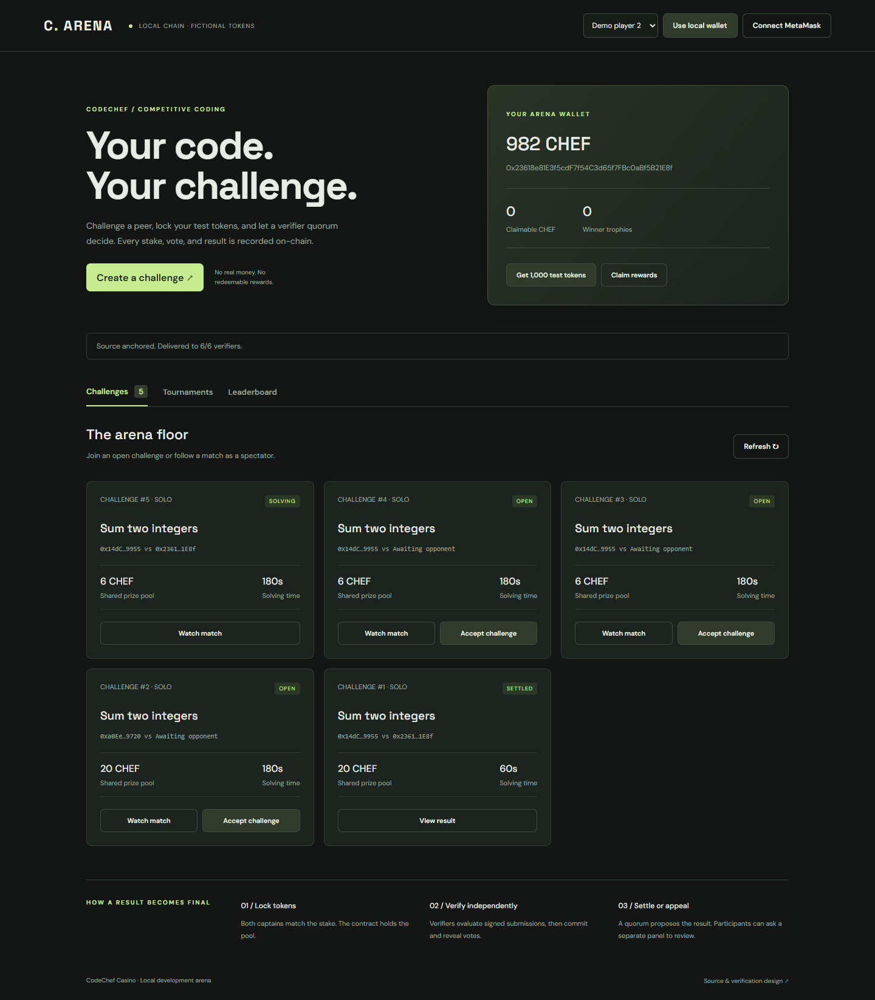

# CodeChef Casino · Local Coding Arena

Wallet-connected coding duels with fictional ERC-20 stakes, on-chain escrow, commit-reveal verifier voting, appeals, and secure reward allocation. Includes **all eight task bonuses**: elimination tournaments, an on-chain leaderboard, teams, a real Docker code sandbox, commit-reveal, multi-party result verification, non-transferable trophies, and spectator mode.

Built for the [CodeChef-VIT blockchain task](docs/TASK.md). **Local blockchain only. CHEF tokens and trophies have no monetary value and cannot be redeemed.** There are no purchases, real-money payments, or public-network configurations.

## Quick start

Requires **Node.js 24**, npm and a running Docker Engine/Desktop. Ports: frontend `5174`, local RPC `18545`, verifier processes `8781-8786`.

```sh
npm ci
docker pull python:3.12-alpine
npm start
```

Open **http://127.0.0.1:5174**. The launcher compiles Solidity with the pinned local compiler, starts Hardhat, deploys the four contracts, starts six verifier processes plus a keeper, and serves the frontend. Keep that terminal open; Ctrl+C stops the stack. The local blockchain resets on restart. Generated artifacts/deployment metadata, verifier secrets and logs are ignored by Git.

In another terminal, run the full example and populate the frontend:

```sh
npm run demo
```

This executes actual signed source delivery, six isolated verifier processes, primary voting, an appeal, settlement and a prize claim. It accelerates **local EVM time**, then leaves a settled match, an open challenge, and a partly filled tournament to explore. Do not run the example while manually playing another timed match, because advancing the shared local clock affects all matches.



## Play

1. Choose **Demo player 1 → Use local wallet**, or connect MetaMask to chain `31337`, RPC `http://127.0.0.1:18545`. Demo mode uses the local node's unlocked accounts and needs no extension. MetaMask needs an account funded with local gas; use a local development account from the Hardhat terminal, never a real funded account. If MetaMask already has chain 31337 configured, ensure its RPC is port 18545.
2. Click **Get 1,000 test tokens** once per address. The example already funds its four players, so their faucet cannot be called twice.
3. Create a solo challenge with a stake and solving duration. The UI approves exactly the stake, then creates it. Another demo wallet can accept by matching the stake.
4. **Watch match** opens the problem/source editor. Each captain submits one Python program before the deadline. For the included problem, read two integers from stdin and print their sum. The button anchors the source hash, signs it, and delivers it to all six verifier nodes. Retry the same source before the deadline if delivery was partial; the on-chain source cannot be replaced.
5. After solving ends, the primary panel independently evaluates both programs inside constrained Docker containers. Two matching votes propose the result. Both passing/both failing is a draw. Participants can dispute during the 30-second review window; the other three verifiers then replay and vote. The keeper progresses expired windows automatically; **Progress result** is also permissionless.
6. Finalized pools become claimable. **Claim rewards** withdraws your Arena and Tournament credits. Spectators can watch without connecting.

For a quick solo win, submit the correct sum program from one wallet and `print(0)` from the other. Missing source fails evaluation. UI action errors (wrong phase, second faucet, unauthorized claim) are surfaced in the status banner.

## Bonus features

| Bonus | Working implementation |
| --- | --- |
| Tournaments | 4/8 entrants, matched fees, two/three elimination rounds, registration timeout refunds, champion pool |
| On-chain leaderboard | Wins/losses/draws/earned recorded by Arena; championships recorded by Tournament; UI ranks contract data |
| Team challenges | 1-4 members per side, explicit teammate consent, captain-funded stake, equal shared rewards with deterministic remainder |
| Sandboxed execution | Real Python 3.12 Docker executions with no network, resource/output/time limits, unprivileged UID and read-only filesystem |
| Commit-reveal | Salted, chain/contract/match/round/signer-bound vote commitments and strictly separate phases |
| Decentralized verification | 2-of-3 primary committee plus separate 2-of-3 appeal panel; six processes independently replay source |
| Achievement trophies | Tournament winner receives a permanently non-transferable ERC-721 with on-chain cup provenance |
| Spectator mode | Live match/cup/standings views and verification event trail without a wallet |

**Teams:** in a match's details, a teammate grants consent to a captain's address. The captain supplies additional members when creating/accepting. The captain pays the whole per-team stake; winners split the complete prize. For draws, each team splits its original stake across its roster. Revoking consent later does not rewrite an existing roster. Captains should understand this shared-pool funding rule.

**Tournaments:** create a 4/8-player cup and join from distinct non-verifier wallets. The final entrant starts the bracket. Fees stay in Tournament; sponsored Arena matches use the same verification/dispute path. Winners advance automatically via the keeper or **Advance bracket**. A drawn match voids the cup and refunds all entrants; incomplete registration also refunds. The champion claims the full entry pool and permanently owns the trophy. Bracket matches appear in the main challenges view.

## Who can be trusted?

One participant, frontend, keeper or verifier cannot unilaterally choose the winner. Captains sign source matching immutable hashes; separate verifier accounts commit/reveal; contracts enforce quorum, deadlines, appeals and terminal settlement. A round without quorum has a bounded draw/refund path, avoiding permanently locked stakes. Claims use checks-effects-interactions, OpenZeppelin SafeERC20 and ReentrancyGuard.

This is **permissioned multi-party verification**, not a trustless execution proof. Two colluding appeal verifiers can choose a false result. All local verifier processes share one host/operator, and Hardhat accounts are unlocked development identities. Commit-reveal mitigates vote copying, not collusion, Sybil attacks or incorrect tests. Keep the entire development stack on loopback. The Docker sandbox is tested but is not a hardened public multi-tenant service. See the [architecture and threat model](docs/ARCHITECTURE.md) for the full trust boundary.

## Verify

```sh
npm test                 # starts a separate disposable Hardhat test chain on 19545
npm run test:sandbox     # actual Docker execution and abuse tests
npm run demo             # requires running npm start; full signed source + appeal flow
npm run build            # production frontend bundle; copies current deployment metadata if present
npm audit --audit-level=moderate
```

Measured locally: **20 contract tests + 8 sandbox tests passed**. Real six-process voting and appeal passed. Chrome desktop/mobile checks exercise creating/accepting challenges, signed code delivery, wallet switching, spectators, cups and standings. [Verification results and evidence](docs/TEST_RESULTS.md). GitHub Actions runs contract, sandbox, full live demo, dependency and frontend build checks from a fresh checkout.

## Project map

- `contracts/`: ChefToken, Arena, Tournament, WinnerTrophy.
- `judge/`: independently configured verifier HTTP process and Docker runner.
- `web/`: wallet/spectator frontend, source editor, matches, cups and standings.
- `scripts/`: local compile/deploy/launcher/keeper and repeatable live demo.
- `test/`: contract state/escrow tests, sandbox tests and optional Chrome smoke test.
- `docs/`: [task](docs/TASK.md), [architecture/diagrams](docs/ARCHITECTURE.md), [deployment/API notes](docs/DEPLOYMENT.md), [results](docs/TEST_RESULTS.md).

The repository origin is `https://github.com/codebreaker77/Blockchain-codecheff.git`. Contract state is local and ephemeral; public cloud/mainnet deployment is intentionally not configured. Current limits include one simple public test problem, no notifications, no secure independent operator custody, no formal security audit, bounded frontend lists, and no persistence of the local chain across restarts.
