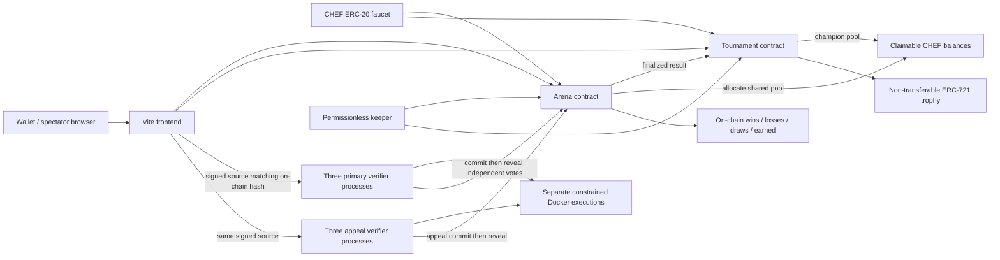

# Architecture and result verification



## Who decides the winner?

The EVM cannot run arbitrary Python or prove that a program passed tests. This implementation uses an immutable, permissioned committee of **three primary verifiers**, requiring **two matching votes**, and a disjoint three-member appeal committee. Every verifier runs its own sandbox evaluations rather than trusting a result supplied by a player or the frontend. The local launcher starts all six processes, using separate signer accounts and separate persisted reports/secrets. This demonstrates multi-party verification; all six running on one developer machine does **not** provide independent real-world operators or fault domains.

A captain anchors `keccak256(UTF8(source))` in the contract before the solving deadline. The hash can be submitted once. A wallet signs a message containing the chain ID, Arena address, match ID and hash; each verifier accepts source delivery only if the signature recovers the matching captain, the source matches its immutable anchor, and the delivery deadline has not passed. Sources are sent to all six nodes in advance so appeals can replay the same program. The frontend supports retrying delivery of exactly that source before the deadline.

For the included immutable problem ID (`codechef-local/sum-two/v1`), each node executes both submitted programs against four fixed versioned cases. One passing program wins; both passing or both failing is a draw. A missing matching source fails evaluation. This is a deliberately small coding judge, not a complete contest platform; the cases are public in source and are not claimed to be secret. Unknown problem hashes are not evaluated by these verifiers and ultimately refund without quorum.

The commitment is:

```
keccak256(abi.encode(chainId, arenaAddress, matchId, round,
                     outcome, evidenceHash, randomSalt, verifierAddress))
```

The salt is saved before committing. Match, round, chain, contract, and signer domain separation prevent cross-context replay. Committing is allowed only after solving ends and before the commit deadline; revealing is allowed only in the next window. Each eligible verifier can commit and reveal once. This prevents copying an already-revealed result before choosing a vote. The evidence hash covers problem, anchored sources, and execution results; events record the hash and result. Full reports/salts stay in each local verifier's ignored data directory. Persist that directory if restarting a verifier mid-round.

Two matching outcome votes form quorum, even if the third disagrees or is absent. Evidence digests need not match because independently executed transcripts may differ. A round without quorum produces a draw/refund outcome. Anyone may call `progress` after the reveal window to propose the primary result. Participants then have a dispute window; any roster member can dispute once using a nonzero reason digest. Disputes freeze all payout and open a fresh commit/reveal round for the **separate appeal panel**. The appeal majority is final; appeal silence/no consensus refunds rather than locking tokens indefinitely. No primary verifier can vote in the appeal round.

## State and timing

```mermaid
stateDiagram-v2
    [*] --> Open: creator funds stake
    Open --> Cancelled: creator cancels or acceptance expires
    Open --> Active: opponent matches stake
    Active --> Active: captains anchor source before solve deadline
    Active --> Proposed: commit / reveal windows end; anyone progresses
    Proposed --> Disputed: participant appeals before deadline
    Proposed --> Settled: dispute window ends
    Disputed --> Settled: appeal reveal window ends
    Cancelled --> [*]: creator claims refund
    Settled --> [*]: recipients claim allocated tokens
```



Default interactive deployment: 120-second commit, 30-second reveal, 30-second dispute windows. Solving time is selected when creating a match. Tests use shorter windows and deterministic EVM time travel. `npm run demo` also advances the local test clock to exercise the full flow quickly. These time controls belong only to an unlocked local development chain.

Contract deadlines use block timestamps and strict phase boundaries. The local deploy script enables a one-second mining interval so deadlines advance without user transactions. A permissionless keeper expires open matches, proposes/finalizes results, advances brackets, and refunds incomplete registrations. It cannot choose a winner, reveal another verifier's secret, or withdraw user rewards. If it stops, contract functions remain callable through the UI or ethers; the blockchain does not execute transactions by itself.

## Tokens, teams, and conservation

CHEF is a conventional OpenZeppelin ERC-20 with a once-per-address 1,000-token faucet. It has no purchase, cash-out, bridge, price, or redeemable reward mechanism. Token/Arena construction is restricted to chain 31337 or 1337; supplied scripts additionally require 31337. No public-network deployment is configured.

Each team contains 1-4 distinct non-verifier addresses. Captains fund the **entire per-team stake**. Every extra member must first consent on-chain to that captain; opposing rosters must have equal sizes and cannot overlap. Consent authorizes inclusion when the roster is formed; later revocation does not edit an already-created match. A captain cannot spend a teammate's tokens. Captains submit one program on behalf of their team; all roster members can appeal.

The winning pool is split equally among its team, with integer-division remainder assigned to the captain. Draws split each original team stake across that team's roster, rather than sending all of it back to its funding captain. This shared-pool rule is explicit, and captains should understand it before funding teammates. Solo draws refund the two original deposits in full. Cancelling an unaccepted match refunds its creator alone.

Settlement records claimable balances before any withdrawal. `claim` uses checks-effects-interactions and OpenZeppelin `ReentrancyGuard`/`SafeERC20`; a second claim fails. A player cannot withdraw another address's credit. No owner sweep exists. Terminal matches cannot settle or dispute again. Direct unsolicited token transfers to contracts are outside escrow accounting and cannot be swept out by an administrator.

Arena records wins, losses, draws, and gross winning match allocations on-chain for every roster member. The frontend ranks by wins then tournament championships, with an address tie-break. The ranking is computed from contract state; there is no off-chain editable scores database. Refunded/cancelled open matches do not award wins. Sponsored tournament matches have zero Arena stake; their champion's entry pool is accounted separately by Tournament.

## Tournaments and trophies

Tournaments accept 4 or 8 distinct entrants. Every entrant deposits the same fee, held in Tournament rather than in Arena. Once full, deterministic registration-order pairs become sponsored solo Arena matches. Only the once-bound Tournament contract can sponsor zero-stake bracket matches. Each match goes through the same result, appeal, and timeout mechanism. Finalized winners advance through two or three elimination rounds. A drawn bracket match voids the cup and refunds every entrant; no arbitrary tie-break chooses a champion. Registration that misses its deadline also refunds all deposits. There are no byes.

The champion receives the whole entry pool as claimable CHEF and one ERC-721 trophy. Trophy ownership is permanent: transfer/update of an existing token reverts, and only the once-bound tournament can mint. Winner counters and trophy-to-cup provenance are on-chain. No NFT marketplace, tradable rewards, or redeemability is implemented.

## Sandbox boundary

Every case launches a fresh `python:3.12-alpine` Docker container: no network, read-only root filesystem, UID/GID 65534, all capabilities dropped, no new privileges, 32-process limit, 64 MiB memory/swap cap, 0.5 CPU quota, 64 open files, a 4 MiB temporary directory, a 6-second wall-clock limit and an 8 KiB combined output cap. Source size is limited to 16 KiB. Source and stdin are passed as arguments/input without a host source mount or shell interpolation. The case expectations and host data are not mounted into the container. Timeout/output abuse force-removes the named container; killing only the Docker client would be insufficient.

The verifier is a privileged local development service in the sense that it can invoke the host's Docker daemon. It is bound to loopback, restricts browser origins, checks signed anchors, serializes evaluation per node, and never mounts the Docker socket into submitted code. Containers share the host kernel: this is **not** a hardened public multi-tenant execution service. A real untrusted public judge should use a dedicated host plus stronger isolation such as a microVM/gVisor and enforce admission quotas, patching, monitoring, and queue limits.

## Trust and limitations

- Two colluding primary verifiers can propose a false result; the participant must appeal during the window. Two colluding appeal verifiers can finalize a false result. Commit-reveal prevents opportunistic copying, not committee collusion or incorrect test specifications. There is no cryptographic execution proof, permissionless/Sybil-resistant verifier selection, staking/slashing, or trustless decentralization claim.
- The local Hardhat node exposes unlocked publicly known development accounts. Anyone controlling this machine/RPC can impersonate them or change time. Keep every service on loopback, never fund these accounts with real assets, and never expose this development RPC to the internet. Real independent operators would each protect their own signing key and run their own nodes/hosts; this local demonstration intentionally does not simulate secure operator custody.
- Wallet connection is implemented via MetaMask and a separate unlocked local-account demo mode. MetaMask rejection/wrong-chain errors are surfaced. No service handles real wallet seed phrases or private keys.
- Data availability matters: source delivery must reach the verifiers before deadline. The hash proves delivered code matches an anchor, not that all nodes received it. Missing/unsupported submissions or offline panels can yield refunds, and repeated disputes can delay settlement once per match. There are no dispute fees in this fictional-token demo.
- Spectator reads and bounded lists come directly from RPC/events. The UI currently lists the latest 100 matches/50 cups/first 200 participants; a larger deployment needs indexing and pagination. Contract view arrays are not designed for unbounded production-scale enumeration.
- In-memory Hardhat state resets when the chain stops. `npm start` compiles and deploys a new session. Artifacts, deployment metadata, local reports and logs are generated/ignored. Startup scripts are not a production orchestration system. The contracts have automated tests, not an independent security audit.

Primary references: [OpenZeppelin ERC-20](https://docs.openzeppelin.com/contracts/5.x/api/token/erc20), [OpenZeppelin utilities](https://docs.openzeppelin.com/contracts/5.x/api/utils), [Hardhat](https://hardhat.org/docs/getting-started), [Docker isolation options](https://docs.docker.com/reference/cli/docker/container/run/).
